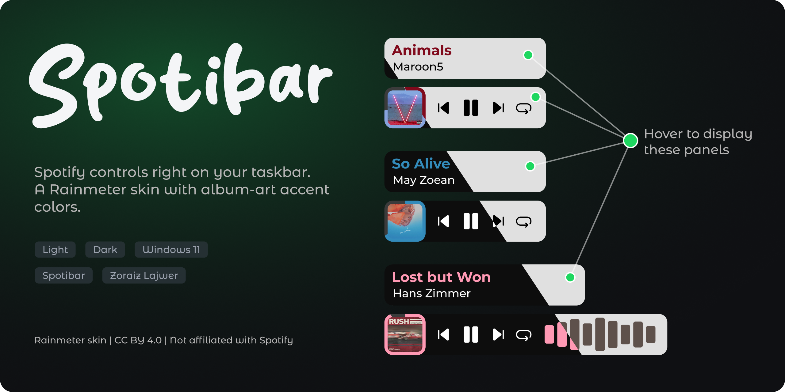
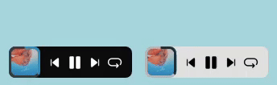
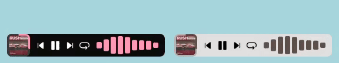
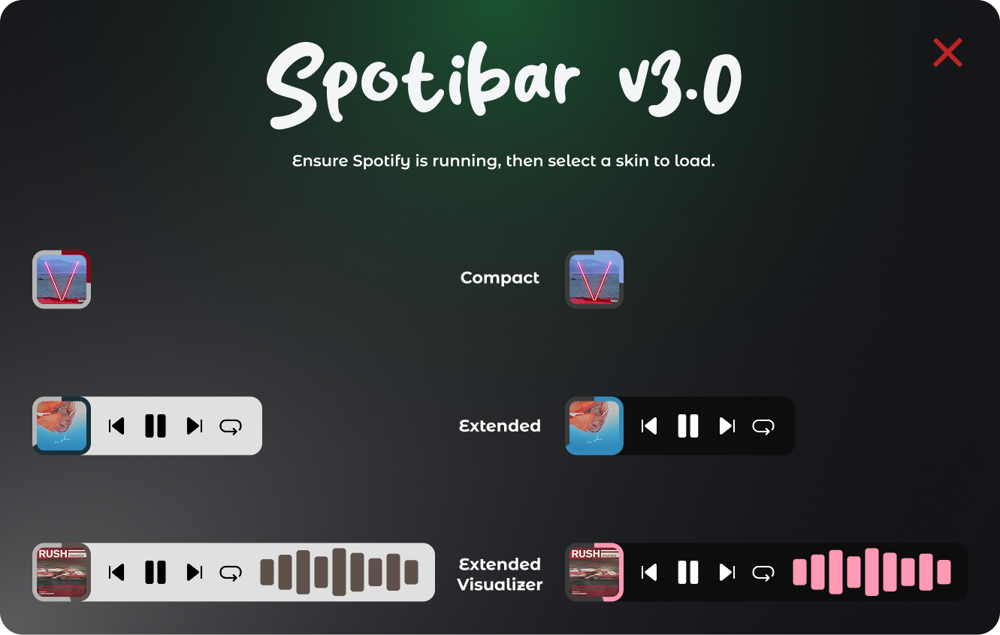
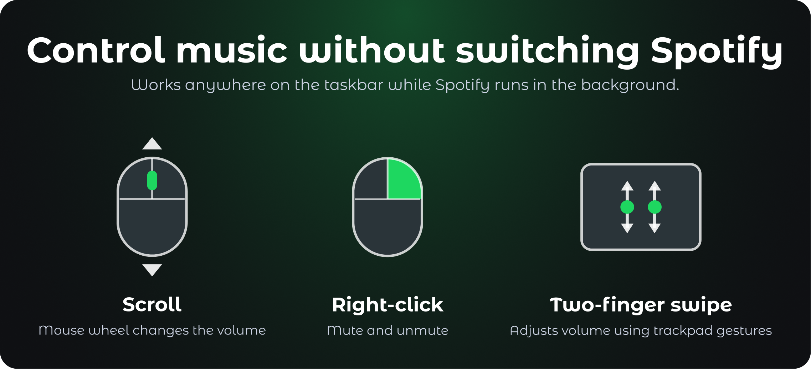
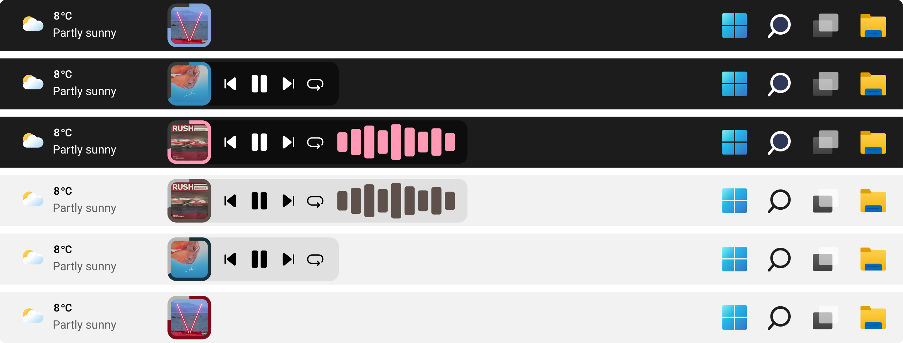

  A Rainmeter skin with album-art accent colors, hover panels and an optional audio visualizer.

  
  
  
  
  

  <a href="https://github.com/ZoraizLajwer/spotibar/releases/latest"><b>Download</b></a> ·
  <a href="#-skins">Skins</a> ·
  <a href="#-features">Features</a> ·
  <a href="#-installation">Installation</a> ·
  <a href="#-troubleshooting">Troubleshooting</a>

  

## 🎬 See it in action

Every skin starts as a small Spotify icon. When Spotify is running it turns into your album cover, and hovering over it reveals the panels.

### Compact

### Extended

### Extended Visualizer

## 🎨 Skins

Spotibar v3.0 ships **six skins**: three layouts, each in a **Light** and a **Dark** theme. A small menu skin lets you load any of them with one click.

### When Spotify is running

| Layout | Dark | Light | Hover |
| --- | :---: | :---: | :---: |
| **Compact** |  |  | 
| **Extended** |  |  | 
| **Extended Visualizer** |  |  | 

### When Spotify is not running

The skin collapses to a Spotify icon. Hover to highlight it in Spotify green, click to launch the app. Once Spotify starts, the skin expands by itself.

| Layout | Dark | Light | Hover |
| --- | :---: | :---: | :---:|
| **Compact** |  |  | 
| **Extended** |  |  | 
| **Extended Visualizer** |  |  | 

## 🖌️ Skin Menu

Click any skin in the menu to toggle it on or off.

## ✨ Features

- **Smart launch and minimize.** Start Spotify from the skin's icon. When Spotify closes, the skin folds back to the standalone icon.
- **Dynamic panels.** Hovering over the album cover reveals the **controls panel** and the **song info panel** (depends on the layout).
- **Quick access.** Click the cover or the info panel to bring the Spotify window to the front.
- **Playback controls.** Previous, Play/Pause, Next and Repeat, with the repeat button showing the current repeat mode.
- **Volume gestures.** Scroll the mouse wheel over the skin, or swipe with two fingers on a trackpad. Right-click to mute and unmute.
- **Adaptive colors.** The progress ring, cover border and song title pick up an accent color from the current album art.
- **Audio visualizer.** The Extended Visualizer skin animates ten bars from your system audio output.
- **Light and Dark themes.** Pair them with your Windows taskbar theme.

### Control Spotify without switching windows

## 🛠️ Installation

### Requirements

| | |
| --- | --- |
| **OS** | Windows 10 or 11 |
| **[Rainmeter](https://rainmeter.net)** | 4.5.28 or newer |
| **[Spotify for Windows](https://www.spotify.com/download/windows)** | Desktop app |

The two plugins Spotibar needs (**WebNowPlaying** and **Chameleon**) are bundled inside the `.rmskin` package. You do not need to install them yourself.

### Steps

1. Install Spotify and Rainmeter.
2. Download **`Spotibar_v3.0.rmskin`** from the [Releases page](https://github.com/ZoraizLajwer/spotibar/releases/latest).
3. Double-click the file and choose **Install**. The skin menu loads automatically.
4. Pick a skin from the menu. Start Spotify and play something.

> **Using Spotify in the browser?** Install the [WebNowPlaying browser extension](https://chromewebstore.google.com/detail/webnowplaying/jfakgfcdgpghbbefmdfjkbdlibjgnbli). Keep the Spotify desktop app minimized instead of fully closed so the skin stays active.

### Recommended skin settings

Right-click the skin (or open it from the Rainmeter manager) and set:

- Position:  `Stay topmost`
- [ ] Draggable (Unchecked)
- [ ] Click through (Unchecked) 

Then drag the skin onto your taskbar where you want it.

### Gaming mode

Because Spotibar stays on top of the taskbar, it can overlap fullscreen games. Use Rainmeter's Game Mode to avoid that:

1. Open Rainmeter and go to **Manage > Game Mode**.
2. Enable **Fullscreen games**.
3. Set **On start** to *Unload all skins*.
4. Set **On stop** to *Reload saved Spotibar layout*.

## 🪟 Taskbar Preview

<!-- The previews in this repo use a restyled Windows 11 taskbar so the skin blends in. -->

<!-- 
1. Install [Windhawk](https://windhawk.net).
2. Inside Windhawk, install the **Windows 11 Taskbar Styler** mod.
3. Apply the [Matter](https://github.com/ramensoftware/windows-11-taskbar-styling-guide/blob/main/Themes/Matter/README.md) theme. -->

## 🧰 Troubleshooting

**The skin only shows the Spotify icon while music is playing.**
Make sure you are using the Spotify desktop app, or the web player with the WebNowPlaying extension installed. If you use the web player, check that the extension is enabled for open.spotify.com.

**The visualizer does not move.**
The visualizer reads your default Windows audio output. Check that Spotify is playing through that device.

**Buttons do nothing.**
Check that **Click through** is unchecked in the skin's settings, then refresh the skin.

**The skin sits on top of a fullscreen game.**
Set up Game Mode as described in the [Gaming mode](#gaming-mode) section above.

**The accent color looks wrong or does not change.**
Accent colors come from the album cover. When a cover has very little color, the skin falls back to a neutral tone.

## 🤝 Contributing

Bug reports, feature ideas and pull requests are welcome. Open an [issue](https://github.com/ZoraizLajwer/spotibar/issues) or send a [pull request](https://github.com/zoraizlajwer/spotibar/pulls).

## 📄 License

Spotibar is licensed under the [Creative Commons Attribution 4.0 International License](https://creativecommons.org/licenses/by/4.0/). You can share and adapt it as long as you give appropriate credit.

The Montserrat font is licensed under the SIL Open Font License 1.1.

## 🙏 Credits

Made by [Zoraiz Lajwer](https://github.com/zoraizlajwer). Built on [Rainmeter](https://rainmeter.net) with the WebNowPlaying and Chameleon plugins.

*Spotibar is an independent project and is not affiliated with or endorsed by Spotify. Spotify is a trademark of Spotify AB.*
